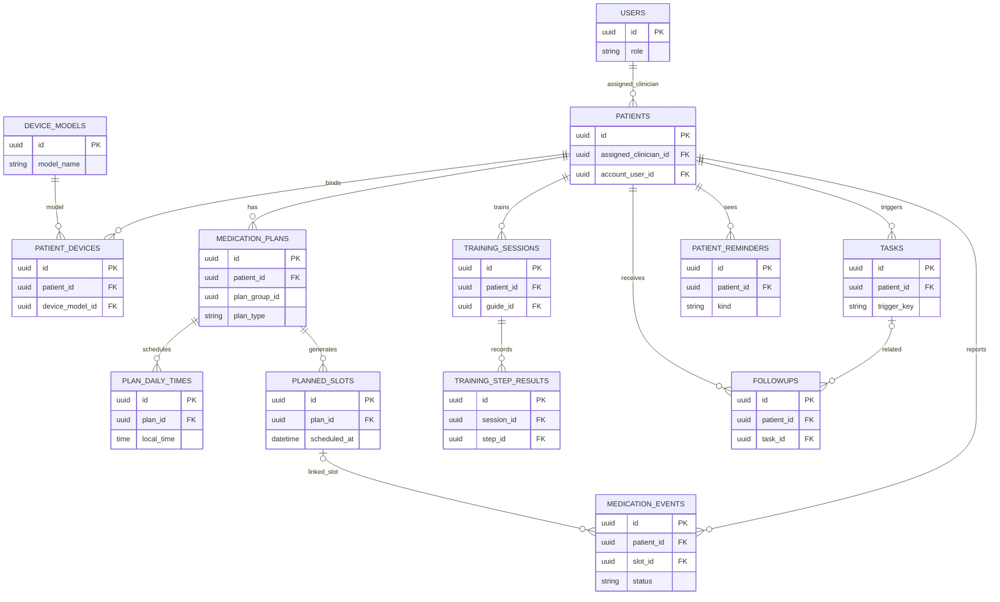
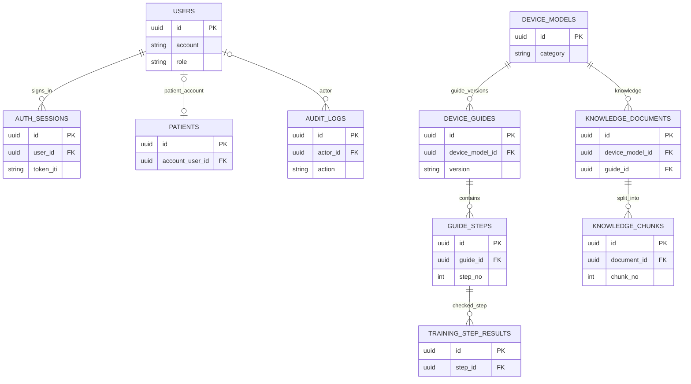

# 吸入治疗指导与依从性辅助管理软件 V1.0｜数据库设计

> 文档：`DATABASE_DESIGN.md` · 版本：1.0 · 日期：2026-10-13  
> 依据：`PRD 1.4` 第 5、7 章和 `TECH_DESIGN.md` 第 4 章。  
> 定位：**简洁的建库指导文档**。业务范围以 PRD 为准；本文补足必要的字段类型、关系和约束，不增加新业务功能。

## 1. 总体设计

- **数据库**：PostgreSQL；**访问层**：FastAPI + SQLAlchemy；**迁移**：Alembic。
- 医护 Web 和患者 Android App **共用一个后端数据库**；App 不维护独立的业务数据库。
- 主要业务表采用 `UUID` 主键 `id`；通用时间字段 `created_at`、`updated_at` 使用 `TIMESTAMPTZ`，统一按 UTC 存储。
- 医疗相关记录只用**模拟数据**开发与演示；角色授权由后端落实，不因表之间存在外键就自动授权访问。
- 统计结果优先从原始用药计划与登记计算，不另建“依从性得分表”。

## 2. ER 实体关系图

图中 `||` 表示一，`o{` 表示零到多，`o|` 表示零或一。为了阅读方便，按业务拆成两张图；所有实体位于**同一个 PostgreSQL 数据库**。

### 2.1 患者、计划、登记与随访（核心）

**关系举例**：一个患者可以有多个用药计划；固定计划生成多个“应登记时点”（`planned_slots`）；一个时点允许关联多条登记历史，但统计时最多计为一个**已登记时点**。按需用药的 `slot_id` 为 `NULL`。

### 2.2 账号、指导知识与 AI 数据

> 注：图示为**主关系**而非全部外键。`PATIENTS.account_user_id`、`MEDICATION_EVENTS.slot_id`、`FOLLOWUPS.task_id` 等均允许为空；`USERS → PATIENTS` 的责任医护关联和患者账号关联是两种不同关系。训练记录还应关联指导版本，详见下表。

## 3. 数据表与关键字段

为避免把文档写得过长，这里采用**表级字段基线**，字段名保持与 PRD 一致。除特别说明外，每张表均有 `id UUID PK`；核心业务表带 `created_at`、`updated_at`，关键写操作保留操作者或审计日志。`?` 表示可空。

| 模块 | 表名 | 主要字段（不重复列出 `id`） |
|---|---|---|
| 账号 | `users` | `account VARCHAR(80)`, `password_hash TEXT`, `role VARCHAR(20)`, `status`, `must_change_password BOOLEAN` |
| 账号 | `auth_sessions` | `user_id UUID FK`, `token_jti VARCHAR(128)`, `expires_at TIMESTAMPTZ`, `revoked_at? TIMESTAMPTZ` |
| 患者 | `patients` | `patient_code VARCHAR(40)`, `display_name`, `diagnosis_label?`, `assigned_clinician_id UUID FK`, `account_user_id? UUID FK` |
| 装置 | `device_models` | `category`（pMDI/DPI/SMI）, `brand`, `model_name`, `manufacturer?`, `status` |
| 装置 | `patient_devices` | `patient_id UUID FK`, `device_model_id UUID FK`, `effective_from TIMESTAMPTZ`, `effective_to? TIMESTAMPTZ` |
| 指导 | `device_guides` | `device_model_id UUID FK`, `version`, `title`, `source_title?`, `source_url?`, `review_status`, `reviewed_by? UUID FK`, `reviewed_at?`, `published_by? UUID FK`, `published_at?` |
| 指导 | `guide_steps` | `guide_id UUID FK`, `step_no INT`, `text TEXT`, `error_notes?`, `image_path?` |
| 用药 | `medication_plans` | `patient_id UUID FK`, `device_model_id UUID FK`, `plan_group_id UUID`, `version INT`, `drug_label`, `plan_type`（REGULAR/PRN）, `timezone`, `starts_at`, `ends_at?` |
| 用药 | `plan_daily_times` | `plan_id UUID FK`, `local_time TIME`, `label?`, `is_enabled BOOLEAN` |
| 用药 | `planned_slots` | `plan_id UUID FK`, `patient_id UUID FK`, `scheduled_at TIMESTAMPTZ`, `state`（ACTIVE/CANCELLED） |
| 用药 | `medication_events` | `patient_id UUID FK`, `plan_id UUID FK`, `slot_id? UUID FK`, `source`, `occurred_at TIMESTAMPTZ`, `recorded_at TIMESTAMPTZ`, `status`（ACTIVE/REVOKED）, `note?`, `revoked_by? UUID FK`, `revoked_at?`, `revoke_reason?` |
| 培训 | `training_sessions` | `patient_id UUID FK`, `device_model_id UUID FK`, `guide_id UUID FK`, `source`, `submit_at`, `result`, `evaluator_id? UUID FK` |
| 培训 | `training_step_results` | `session_id UUID FK`, `step_id UUID FK`, `check_state`, `note?` |
| 核查 | `tasks` | `patient_id UUID FK`, `task_type`, `trigger_key`, `status`（OPEN/IN_PROGRESS/CLOSED）, `assigned_to UUID FK`, `due_at?`, `closed_at?` |
| 随访 | `followups` | `patient_id UUID FK`, `task_id? UUID FK`, `clinician_id UUID FK`, `followed_at`, `feedback?`, `action_taken?`, `next_plan?` |
| 提醒 | `patient_reminders` | `patient_id UUID FK`, `kind`, `title`, `due_at?`, `status`, `related_followup_id? UUID FK`, `related_training_id? UUID FK`, `created_by UUID FK`, `completed_at?` |
| AI | `knowledge_documents` | `device_model_id UUID FK`, `guide_id? UUID FK`, `title`, `version`, `review_status`, `source_url?`, `reviewed_by? UUID FK`, `reviewed_at?`, `published_by? UUID FK`, `published_at?` |
| AI | `knowledge_chunks` | `document_id UUID FK`, `chunk_no INT`, `text TEXT`, `embedding?`（P1 可选） |
| 审计 | `audit_logs` | `actor_id? UUID FK`, `action`, `resource_type`, `resource_id UUID`, `detail JSONB`, `created_at TIMESTAMPTZ` |

**说明**：`patient_reminders` 是 `TECH_DESIGN.md` 对 PRD 站内提醒需求的最小实现补充：**今日计划提醒动态计算**；仅医护安排的复训/随访提醒持久化。模型扩展字段（如枚举具体值、备注长度）由 SQLAlchemy/Alembic 首次迁移固定，但不得改变以下业务约束。

## 4. 必须保证的数据约束

| 规则 | 数据库 / 服务层实现 |
|---|---|
| 账号与患者唯一 | `users.account`、`patients.patient_code` 唯一；`patients.account_user_id` 唯一（为空时允许多个） |
| 指导版本不可互相覆盖 | `UNIQUE(device_model_id, version)`；`UNIQUE(guide_id, step_no)`；发布后禁止原地修改，修改需新版本 |
| 计划版本与时点 | `UNIQUE(plan_group_id, version)`；**同组计划生效区间不重叠**，不同组可并存；`UNIQUE(plan_id, scheduled_at)` |
| 固定 / 按需区分 | REGULAR 登记必须有属于同一患者与计划的 `slot_id`；PRN 登记 `slot_id=NULL`；使用服务层事务校验 |
| 撤销与覆盖率 | 登记允许重复，不对 `medication_events.slot_id` 加唯一约束；撤销标记 `REVOKED` 不硬删；统计 `COUNT(DISTINCT slot_id)` |
| 核查任务去重 | `tasks.trigger_key` 唯一；同一患者同类型最多一条 OPEN/IN_PROGRESS 任务（PostgreSQL 部分唯一索引） |
| 访问隔离 | 医护查询只访问其 `assigned_clinician_id` 负责的患者；患者只访问自己的 `account_user_id` 档案；每个业务 API 服务端校验 |
| 审核与安全 | 仅已发布指导和知识参与患者查询/AI 检索；审计记录关键操作；密码、Token、完整 AI 敏感输入不得写入审计详情 |

**时间与计算口径**：日期区间采用左闭右开 `[start, end)`，事件时间保留 UTC；按计划 `timezone`（默认 `Asia/Shanghai`）生成每日固定时点。`occurred_at` 是自报发生时间，`recorded_at` 是服务端登记时间。覆盖率 `M/N×100%`：`N` 为窗口内已到期的有效 REGULAR 时点数，`M` 为其中存在 ACTIVE 登记的不同 `slot_id` 数；`N=0` 返回 `null`，不显示 0%。该指标不是经硬件验证的实际用药依从性。

**关联删除策略**：已产生训练、用药、随访、审计的历史记录**不级联物理删除**。停用账号、关闭计划、撤销登记使用状态或有效期；对于核心历史记录关联使用 `RESTRICT/NO ACTION`。只允许删除尚未发布且无关联历史的草稿数据。

## 5. 建库、模拟数据与验收

1. **迁移顺序**：`users → auth_sessions/patients/device_models → 指导与装置绑定 → medication_plans/plan_daily_times/planned_slots → 用药和训练 → tasks/followups/patient_reminders → AI 知识与审计`；实际通过 Alembic 外键依赖确定执行顺序。
2. **初始化**：提供 `alembic upgrade head` 和独立种子脚本；准备 Admin 1、医护 A/B 2、患者 X/Y 2 等测试账号，以及至少 10 个明确标记为 DEMO 的虚构患者。
3. **核心数据测试**：7 天每天 2 次计划得到 `N=14`；10 个不同 slot 有效登记得到 `M=10`、覆盖率 `71.4%`；同一 slot 重复登记不增加 M，撤销后按剩余有效记录重算。
4. **一致性测试**：计划换版本后历史结果不变；PRN 不生成固定 slot；连缺 3 个到期 slot 只生成一个未关闭任务；医护 B 与患者 Y 不得访问患者 X 的数据。
5. **交付检查**：迁移可从空库重建，种子可重复运行而不制造重复数据；附简短建库说明与 ER 图；不接真实患者数据。

---

> **开发准则**：以 PRD 1.4 为需求边界，以 `TECH_DESIGN.md` 为业务实现依据。本文件优先固定**表关系、主外键、唯一约束及统计口径**；不为尚未实现的硬件连接、离线同步、AI 预测额外建表。
