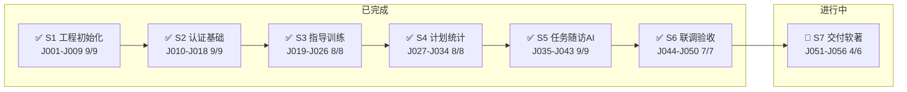
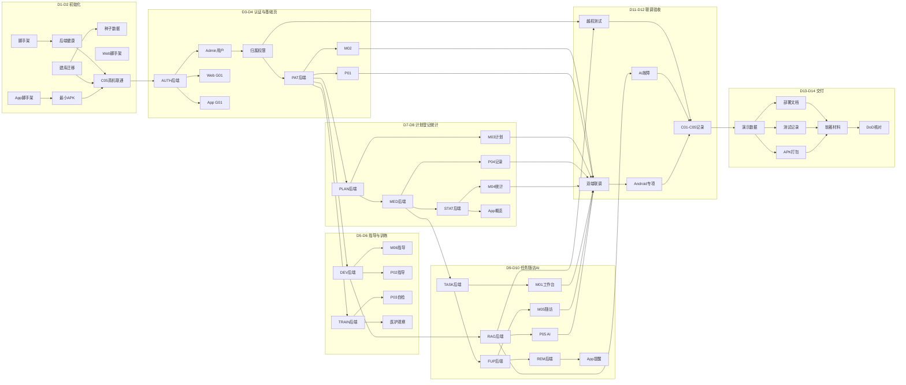

# 吸入治疗指导与依从性辅助管理软件 V1.0｜开发任务拆解（TASKS）

| 项目 | 内容 |
|---|---|
| 文档版本 | TASKS 1.0 · 2026-10-15 |
| 依据 | PRD 1.5、TECH_DESIGN 1.1、DATABASE_DESIGN 1.0、API_SPEC 1.0、UX_DESIGN 1.0、UI_DESIGN 1.1 |
| 状态 | **开发执行基线**；随实现进展回填「状态/完成日期」，未通过项不得标记完成 |
| 配套 | 任务明细分阶段存放在 `Task-1.0/`，本文件为**总纲与索引** |

> **使用约定**：本文件是 14 天交付的**唯一任务地图**，把 PRD 的「做什么」和 TECH_DESIGN 的「怎么做」切成**可验证、有依赖、有完成定义（DoD）**的执行单元。每个任务都挂 PRD 编号与验收用例，不允许开发时悄悄新增、删减或重定义需求。出现设计文档冲突时，以 PRD 业务范围与验收为准，先记录冲突点再决策。

---

## 0. 日期基准与动态进度（每次开工先更新这里）

- **D1 锚点日期**：`2026-10-13`（周二）——以首份设计文档《软著PRD-V1.5.md》的创建时间为准（当天 20:12 起稿）。
- **进度快照（最近更新：2026-10-16 周五 12:30）**：今天 = **D4（第 4 天）**。S1–S6 核心功能与交付物已完成，本轮额外完成 **Web 端实测走查 + 缺陷修复 + 功能丰富 + 视觉优化**。

### 路径地图（全局进度一览）



### 各阶段进度明细

| 阶段 | 任务区间 | 完成度 | 状态 | 关键验收 |
|---|---|---|---|---|
| S1 工程初始化与建库 | J001–J009 | 9/9 | ✅ 完成 | C05 真机联网通过 |
| S2 认证与基础页面 | J010–J018 | 9/9 | ✅ 完成 | T01/T02 通过 |
| S3 型号指导与训练 | J019–J026 | 8/8 | ✅ 完成 | T03–T05 通过 |
| S4 计划登记与统计 | J027–J034 | 8/8 | ✅ 完成 | T06–T09/T16 通过 |
| S5 任务随访与 AI | J035–J043 | 9/9 | ✅ 完成 | T10–T13 通过 |
| S6 联调验收与修复 | J044–J050 | 7/7 | ✅ 完成 | T01–T16 全通过；Web 端实测走查（见下） |
| S7 交付与软著 | J051–J056 | 4/6 | 🔄 进行中 | 文档/说明书/鉴别材料完成；APK 与患者端截图待真机 |

### 本轮增补（2026-10-16，不占原 56 任务编号）

| 类别 | 内容 |
|---|---|
| 🐛 缺陷修复 | ① 登录失败无提示（401 误判为会话失效）；② `daily-slots` 500（漏 `import time`）；③ 工作台随访只取首患者；④ 种子脚本幂等性缺陷（计划重复） |
| ✨ 功能补齐 | M02 **患者详情页**（档案/装置/计划/登记/训练/随访 6 区）；App **P01 今日首页**按 UI_DESIGN §6 重写（下一步卡 + 88px 环形进度 + 今日时点卡） |
| 🎨 视觉优化 | 12 个线性 SVG 图标替换 emoji；修复"未到时点"标签与 antd 占位符对比度；截图 lint 警告降为 0 |
| 🧪 质量 | 全量回归 **16 PASS / 0 FAIL**；AI 边界样本 **22/22 PASS**；演示数据动态日期化（任意日期可复现 71.4%） |

### S6 完成情况

| 任务 | 内容 | 状态 |
|---|---|---|
| J044 越权隔离 | 医护/患者越权 404/403、伪造 source 重写、停用账号失效 | ✅ 通过（17/17） |
| J045 AI 故障回退 | AI 边界兜底、核心接口隔离、跨型号 403 | ✅ 通过（13/13） |
| J046 双端联调 | Web/App 同 API；Web 端 6 页面实测通过 | ✅ 通过 |
| J047 Android 专项 | 冷启动已验；断网/返回键待真机 | 🟡 部分（待真机补 C02/C04） |
| J048 C01–C05 记录 | 已归档；C02/C03/C04 现场操作待补 | 🟡 部分 |
| J049 全量回归 | T01–T16 | ✅ 通过（16/16） |
| J050 缺陷修复 | 见上表 | ✅ 完成 |

| J046 双端联调（C03） | 医护建档→App 可见→App 登记→Web 可见 | ⏳ 待真机 |
| J047 Android 专项（C02/C04） | 冷启动重登、断网不假成功 | ⏳ 待真机 |
| J048 汇总 C01–C05 | 全量验收记录归档 | ⏳ 待真机 |

---

**S1 阶段实际进展**：


| 第几天 | 日期 | 星期 | 阶段 | 主题 | 日历进度 |
|---|---|---|---|---|---|
| D1 | 2026-10-13 | 周二 | S1 | 工程初始化与建库 | 已过（实际完成） |
| D2 | 2026-10-14 | 周三 | S1 | 工程初始化与建库 | 已过（实际完成） |
| D3 | 2026-10-15 | 周四 | S2 | 认证与基础页面 | **← 今天**（实际已推进到 S6） |
| D4 | 2026-10-16 | 周五 | S2 | 认证与基础页面 | 未到 |
| D5 | 2026-10-17 | 周六 | S3 | 型号指导与训练 | 未到 |
| D6 | 2026-10-18 | 周日 | S3 | 型号指导与训练 | 未到 |
| D7 | 2026-10-19 | 周一 | S4 | 计划、登记与统计 | 未到 |
| D8 | 2026-10-20 | 周二 | S4 | 计划、登记与统计 | 未到 |
| D9 | 2026-10-21 | 周三 | S5 | 任务、随访与 AI | 未到 |
| D10 | 2026-10-22 | 周四 | S5 | 任务、随访与 AI | 未到 |
| D11 | 2026-10-23 | 周五 | S6 | 联调、验收与修复 | 未到 |
| D12 | 2026-10-24 | 周六 | S6 | 联调、验收与修复 | 未到 |
| D13 | 2026-10-25 | 周日 | S7 | 交付与软著材料 | 未到 |
| D14 | 2026-10-26 | 周一 | S7 | 交付与软著材料 | 未到 |

> **动态更新规则**：本计划是滚动日历。当前实际开发**大幅超前**于日历（D3 当天已完成 S1–S6 核心功能），原因是集中式推进。日历只作参考，真实进度以上方「各阶段进度明细」为准。

---

## 1. 任务地图与阶段总览

按 PRD 第 11 章「十四天交付计划」切分为 **7 个阶段 / 56 个任务**。任务统一编号 `J###`；阶段对应 `Task-1.0/` 下一个 `.md` 文件。

| 阶段 | 日期 | 主题 | 任务区间 | 里程碑（必须通过） | 明细文件 |
|---|---|---|---|---|---|
| S1 | D1–D2 | 工程初始化与建库 | J001–J009 | C05 真机联网、最小 APK、空库可重建 | `Task-1.0/01-D1D2-工程初始化与建库.md` |
| S2 | D3–D4 | 认证与基础页面 | J010–J018 | T01、T02 通过，C01/C02 部分 | `Task-1.0/02-D3D4-认证与基础页面.md` |
| S3 | D5–D6 | 型号指导与训练 | J019–J026 | T03–T05 通过，C03 部分 | `Task-1.0/03-D5D6-指导与训练.md` |
| S4 | D7–D8 | 计划、登记与统计 | J027–J034 | T06–T09、T16 通过 | `Task-1.0/04-D7D8-计划登记与统计.md` |
| S5 | D9–D10 | 任务、随访与 AI | J035–J043 | T10–T13 通过 | `Task-1.0/05-D9D10-任务随访与AI.md` |
| S6 | D11–D12 | 联调、验收与修复 | J044–J050 | T14、T15、C01–C05 通过 | `Task-1.0/06-D11D12-联调与验收.md` |
| S7 | D13–D14 | 交付与软著材料 | J051–J056 | DoD 与交付清单全项核对 | `Task-1.0/07-D13D14-交付与软著.md` |

**阻塞规则**（继承 TECH_DESIGN §7.4）：D2 的真机网络/最小 APK 未打通，不应让所有开发只围绕浏览器页面推进；医学指导未审核时，不得把样例指导/AI 问答标记为正式审核通过，也不得宣称对应验收项通过。

---

## 2. 编号与任务卡规范

### 2.1 编号规则

- 任务号 `J###` 全局唯一、单调递增，**不因后续增删而重排历史编号**；新增任务追加编号，废弃任务标记 `已取消` 并保留记录。
- 阶段号 `S1–S7` 对应日期窗口；一个任务只属于一个阶段。
- PRD 需求编号（AUTH/PAT/DEV/TRAIN/PLAN/MED/REM/STAT/TASK/FUP/AI/KB + 验收 T/C）为**追溯键**，任何任务都必须至少挂一个 PRD 编号。

### 2.2 统一任务卡模板

每个任务在阶段明细文件中使用同一结构：

```markdown
### J### 任务标题
- 阶段：S# ｜ 端：[后端 / Web / App / 双端 / 运维 / 交付]
- PRD 依据：需求编号（P0/P1/P2）
- 依赖：前置任务编号（无则写 `—`）
- 产出物：可核对的文件/产物路径
- 完成定义（DoD）：
  - [ ] 明确可验证的结果
- 验收用例：T## / C##（关联 PRD 第 10 章）
- 负责人：角色或姓名 ｜ 状态：未开始 / 进行中 / 已完成（附日期）
- 风险/说明：（可选）
```

### 2.3 状态约定

| 状态 | 含义 |
|---|---|
| 未开始 | 尚未动工 |
| 进行中 | 已开工未达 DoD |
| 已完成 | 全部 DoD 勾选，验收用例通过并留记录 |
| 受阻 | 依赖未满足或被阻塞，需在「风险」注明阻塞条件 |
| 已取消 | 经评审不再需要（保留编号与原因） |

---

## 3. 依赖关系图（关键路径）



> 依赖关系为**建议执行顺序**；无强依赖的任务可并行推进。凡「后端字段/接口」未冻结前，对应前端不得按猜测造字段（API_SPEC §3.1）。

---

## 4. 里程碑与验收矩阵

### 4.1 里程碑（阶段门槛，缺一不可）

| 里程碑 | 触发节点 | 判定 |
|---|---|---|
| M1 骨架可跑 | S1 末 | `GET /api/health` 通；空库迁移可重建；最小 APK 真机联网 |
| M2 可登录隔离 | S2 末 | Web/App 登录改密退出；医护 A/B 与患者 X/Y 隔离 |
| M3 可学习可评估 | S3 末 | 型号指导审核发布、自检与医护观察来源区分 |
| M4 可记录可统计 | S4 末 | 固定/PRN、版本、撤销、N/M/source_breakdown 正确 |
| M5 可闭环可问答 | S5 末 | 待核查任务幂等、随访闭环、AI 型号限定兜底 |
| M6 双端可验收 | S6 末 | T01–T16、C01–C05 全部通过并留记录 |
| M7 可交付 | S7 末 | DoD 全项达成，软著材料与实际形态一致 |

### 4.2 验收用例 → 任务映射（追溯表）

| 用例 | 主要任务 | 用例 | 主要任务 |
|---|---|---|---|
| T01 | J010 J011 J013 J014 | T09 | J027 J029 J030 J031 |
| T02 | J012 J015 J016 J044 | T10 | J035 J036 J037 |
| T03 | J019 J020 J021 | T11 | J037 J038 |
| T04 | J022 J023 | T12 | J041 J042 |
| T05 | J022 J024 | T13 | J041 J042 |
| T06 | J027 J028 J031 J032 | T14 | J041 J045 |
| T07 | J029 J030 J031 | T15 | J012 J044 |
| T08 | J027 J028 J031 | T16 | J029 J030 J031 |
| C01 | J016 J020 J036 J038 J044 J048 | C02 | J014 J047 J048 |
| C03 | J017 J021 J023 J030 J042 J048 | C04 | J030 J047 J048 |
| — | — | C05 | J008 J009 J047 J048 |

---

## 5. 完成定义（DoD，最终核对清单）

- [ ] 所有 P0 需求可在**真实运行的软件**中操作，不只是静态截图。
- [ ] T01–T16（16 条）与 C01–C05（5 条）均执行并记录结果；未通过项如实标注，不宣称完成。
- [ ] 至少 5 个演示账号（Admin 1、Clinician A/B 2、Patient X/Y 2）、10+ 个 `DEMO` 标记患者、2–3 个已审核型号指导；未审核则记为交付阻塞项。
- [ ] Web/后端可按 README 从空库迁移启动；App 可按 ANDROID_BUILD 复现 APK 构建并真机安装；D1–D2 联网与防火墙规则有记录。
- [ ] 交付物齐备（PRD §11.2）：三端源码与锁文件、迁移/种子脚本、OpenAPI、部署/打包说明、APK、测试记录、说明书、双端真实截图。
- [ ] 软著名称「**吸入治疗指导与依从性辅助管理软件**」V1.0 贯穿界面标题、README、说明书、版本信息；截图与说明书不出现未实现的硬件监测/离线同步/系统推送等表述。

---

## 6. 阶段明细文件导航

| 文件 | 内容 |
|---|---|
| [01-D1D2-工程初始化与建库.md](Task-1.0/01-D1D2-工程初始化与建库.md) | J001–J009：命名冻结、三端脚手架、建库迁移、种子数据、最小 APK、C05 |
| [02-D3D4-认证与基础页面.md](Task-1.0/02-D3D4-认证与基础页面.md) | J010–J018：AUTH/PAT 后端、双端 G01、M02、P01 |
| [03-D5D6-指导与训练.md](Task-1.0/03-D5D6-指导与训练.md) | J019–J026：DEV/TRAIN 后端、M06、P02/P03、医护观察、审计 |
| [04-D7D8-计划登记与统计.md](Task-1.0/04-D7D8-计划登记与统计.md) | J027–J034：PLAN/MED/STAT 后端、M03/M04、P04、App 概览 |
| [05-D9D10-任务随访与AI.md](Task-1.0/05-D9D10-任务随访与AI.md) | J035–J043：TASK/FUP/REM/KB-RAG 后端、M01/M05、P05、App 提醒 |
| [06-D11D12-联调与验收.md](Task-1.0/06-D11D12-联调与验收.md) | J044–J050：越权/AI 故障/双端联调/Android 专项/C01–C05 记录/回归 |
| [07-D13D14-交付与软著.md](Task-1.0/07-D13D14-交付与软著.md) | J051–J056：演示数据、部署打包文档、测试记录、APK、软著材料、DoD 核对 |

---

## 7. 文档来源与维护规则

- 需求边界：`软著PRD-V1.5.md`；实现依据：`TECH_DESIGN.md`；字段约束：`DATABASE_DESIGN.md`；接口契约：`API_SPEC.md`；流程：`UX_DESIGN.md`；视觉：`UI_DESIGN.md`。
- 变更规则：开发期新增需求必须注明影响的页面 ID、数据表、API、用例 ID、任务编号和排期；涉及 Android 构建或网络会话时说明 APK/签名、真机联网与 C05 验收影响（PRD §13）。
- P2 功能（真实设备接入、离线同步、系统推送、iOS、商店上架等）**不在 V1.0 交付声明中体现为「已实现」**。
