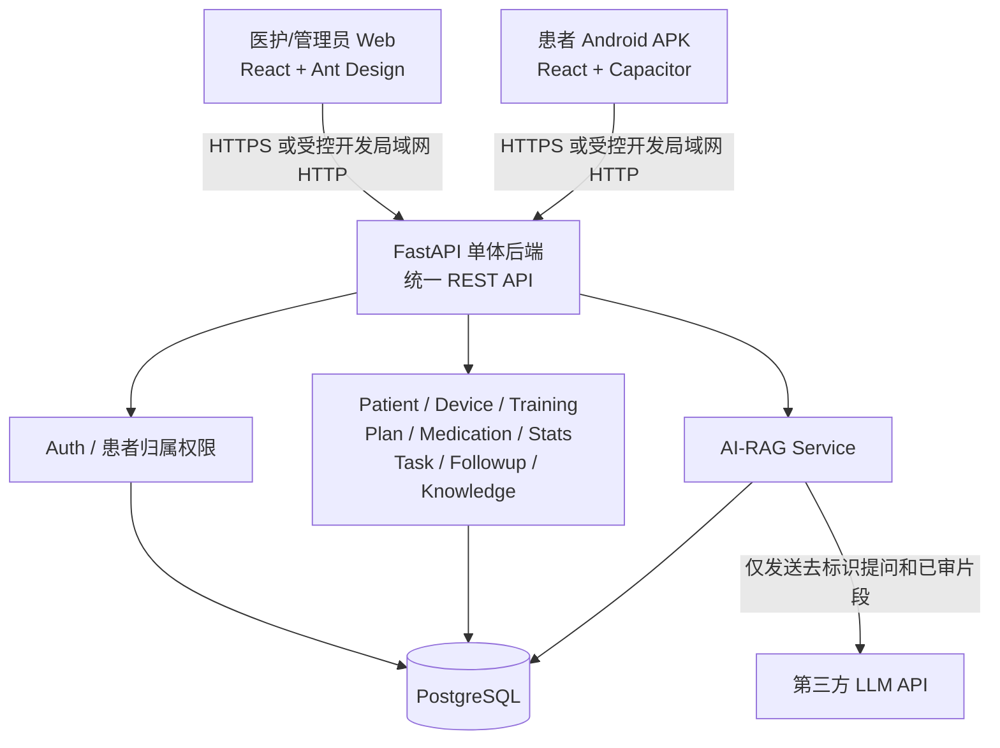
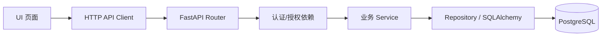
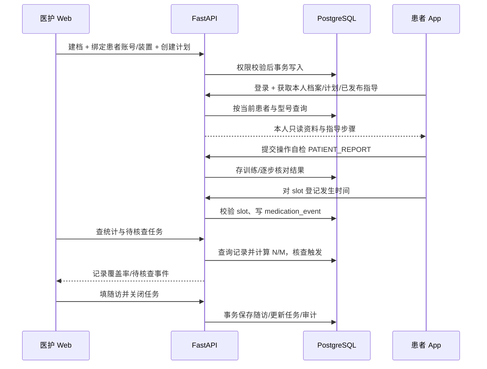
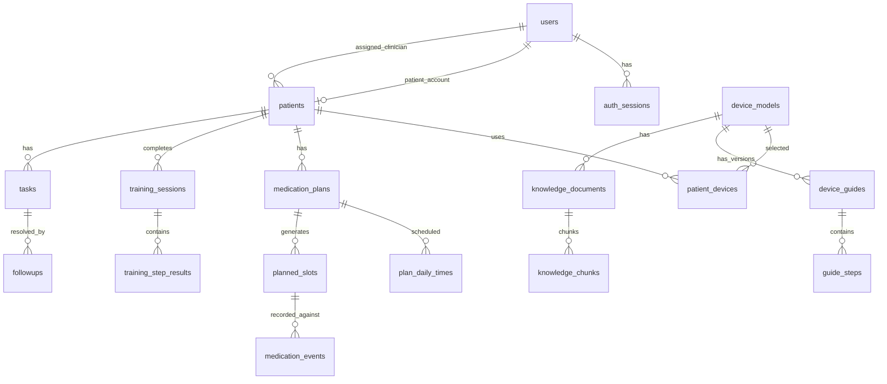
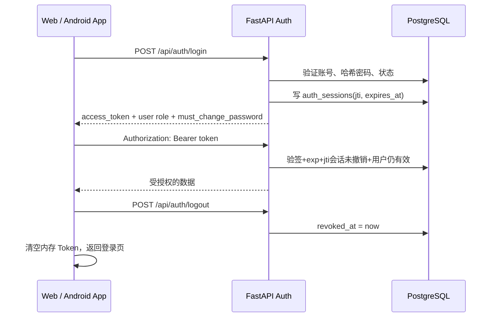
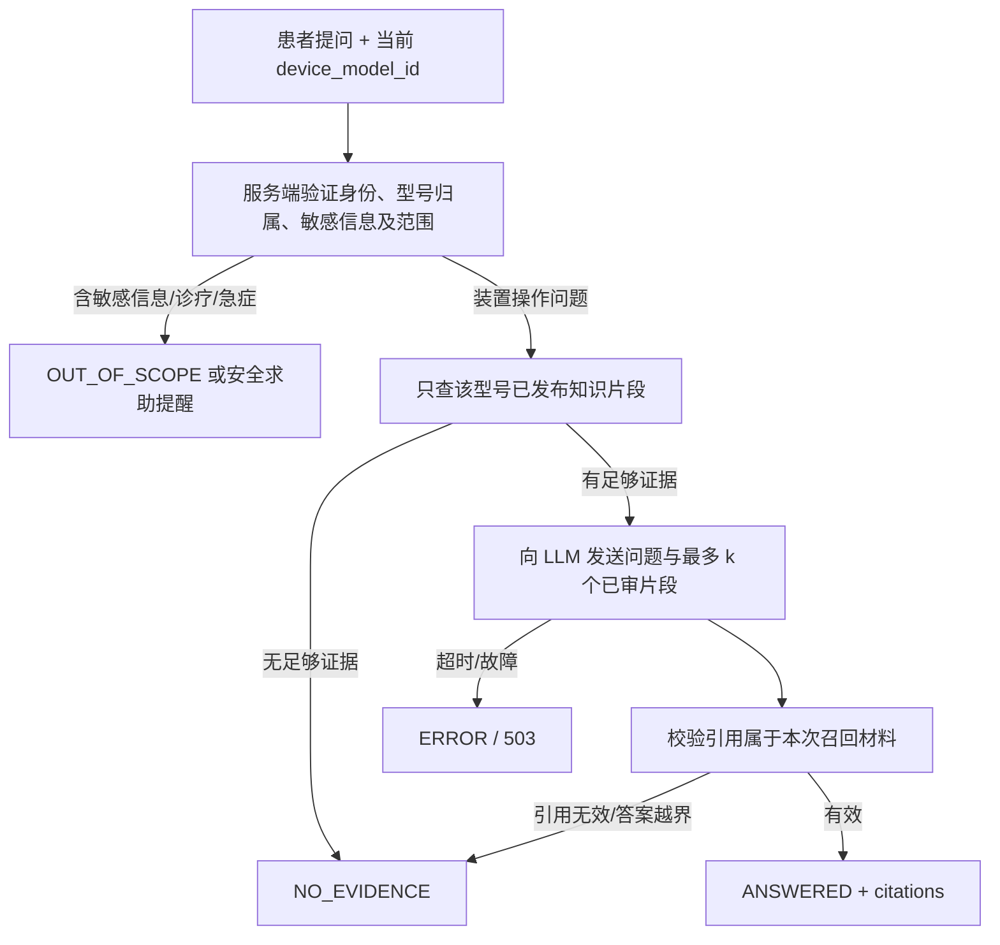

# 吸入治疗指导与依从性辅助管理软件 V1.0 — 技术设计文档（TECH_DESIGN）

| 项目 | 内容 |
|---|---|
| 文档版本 | TECH_DESIGN 1.1 |
| 编制日期 | 2026-10-13 |
| 对应需求基线 | 《吸入治疗指导与依从性辅助管理软件 V1.0》PRD 1.5 |
| 项目目标 | 14 天交付医护 Web、患者可安装 Android APK、统一后端与软著相关材料 |
| 文档状态 | **开发技术基线（实施前需执行 D1–D2 环境验证）** |
| 数据使用范围 | 演示原型、模拟患者数据；未经审核及评估不得用于真实临床 |

> **TECH_DESIGN 1.1 变更摘要**：与 PRD 1.5 同步完成三项一致性修订 —— ①明确任务生成时效口径（核查任务最多一个扫描周期延迟）并给出 T10 验收正确做法，同时补充演示部署必须单工作进程的硬约束；②定义 `planned_slots.state` 枚举为 `ACTIVE` / `CANCELLED`，明确到期与缺失为查询时动态判定；③冻结 `source_breakdown` 语义为「有效登记事件按来源计数」，取消并行字段名 `active_event_source_counts`。业务范围、数据模型与 REST API 未变更。

> **使用与优先级约定**：PRD 1.5 规定“做什么”和验收边界；本文规定“怎么做”。发现与 PRD 不一致时，以 PRD 的业务范围和验收标准为准，提交变更审查，不允许开发 Agent 悄悄新增、删减或重定义需求。本文中注明「技术设计决定」的细节，是为了让工程实现具有唯一落点；属于内部实现方案，不等于新增用户功能。`DATABASE_DESIGN.md` 与 `API_SPEC.md` 后续分别细化字段约束和请求/响应 Schema，不应另造一套互相矛盾的业务口径。

## 0. 设计摘要与冻结边界

### 0.1 最终技术选型

| 层次 | 选型 | 决定 |
|---|---|---|
| 医护/管理员客户端 | React + TypeScript + Vite + Ant Design + React Router | `frontend-web/`，桌面浏览器 |
| 患者客户端 | React + TypeScript + Vite + React Router + Capacitor Android | `patient-app/`，产出可安装 APK；移动端界面独立实现 |
| 后端 | Python 3.11+ + FastAPI + Pydantic + SQLAlchemy + Alembic | 一个模块化单体服务，统一 REST API |
| 数据库 | PostgreSQL | 唯一业务数据库；核心表 UUID 主键 |
| AI | 可替换的 LLM API + 型号/发布版本严格过滤的轻量 RAG | AI 仅用于已审核装置知识问答 |
| 代码管理 | 一个 Git 仓库（Monorepo），三套应用目录 | 单次交付、可复现构建；前后端通过接口契约配合 |
| 构建/部署 | 本地 Web、FastAPI/PostgreSQL + Android Studio/Gradle 构建 APK | D2 完成最小真机联调；不要求应用商店上架 |

选用**模块化单体**，不用微服务、Kubernetes、Redis、消息队列、WebSocket 或独立 AI 微服务。首版可以按业务模块拆文件，但统一部署、统一鉴权、统一数据库事务。

### 0.2 不做的事情（严禁实现后冒充已完成）

真实吸入设备连接、蓝牙/传感器、摄像头动作识别、吸气量测量、AI 诊疗/剂量建议、HIS/EMR 对接、iOS 安装包、商店上架、系统推送、离线登记与自动同步、患者端本地医疗数据持久缓存、多 Agent；CSV/PDF 美化导出属于 P1，不得抢占 P0 时间。

### 0.3 核心设计原则

1. 业务权限在**后端每次验证**，客户端路由与隐藏菜单仅用于改善体验。
2. 所有可影响统计的数据采用**可追溯写入**：登记可撤销但不硬删除，计划/指导变更产生新版本。
3. **记录覆盖率不是实际服药依从性**；缺失代表“没有有效记录”，不直接断言漏服药。
4. **AI 仅解释已审核资料**；没有证据、跨型号或诊疗决策问题必须安全兜底。
5. App 是打包进 Android 工程的**可安装应用**，不是 H5 链接/PWA；V1.0 在线运行。
6. D1–D2 优先证明完整链路可运行，然后纵向逐个实现功能。

---

# 1. 系统总体架构

## 1.1 逻辑组件与调用边界



- Web/Android 只负责展示、交互、输入初步校验和状态管理；**统计、任务触发、版本更新、权限判断都由后端执行**。
- 两客户端共用一个 API 根路径 `/api`。不会为了 Android 增设一套“App 专用后端”或单独数据库。
- AI API Key 只存在后端环境变量中，绝不放进 APK 或浏览器静态资源。
- 开发演示数据库只放 10+ 虚构患者与模拟业务记录，不接入真实身份信息、病历和处方。

## 1.2 运行与环境划分

| 环境 | 用途 | API 通信 | 数据 |
|---|---|---|---|
| Local | 电脑独立开发 Web/后端 | `http://127.0.0.1:8000`（只允许同机访问） | 模拟数据 |
| LAN-Debug | D1–D2 和日常 Android 真机联调 | 手机连接 `http://<开发机IPv4>:8000`；服务端监听 `0.0.0.0:8000` | **仅模拟数据** |
| Demo / 非调试交付 | 给委托方演示 Web + APK | 推荐具备可信 TLS 证书的 HTTPS API；若仅交付受控调试 APK，必须显著说明其联网限制 | **仅模拟数据** |

**限制**：`0.0.0.0` 是服务端监听地址，绝对不是手机侧的 API URL。Windows 局域网联调还必须检查专用网络 TCP 8000 受限入站、防火墙、路由器访客隔离和 VPN；不能通过关闭防火墙来“修复”问题。

非调试 APK 不允许为方便演示而启用全局明文 HTTP、不允许跳过 TLS 验证。**Android 调试包 HTTP 例外与非调试构建分离**。如果交付前没有 HTTPS 后端，只能如实交付并注明“受控局域网调试演示包”，不可称为已准备好公开部署的正式发布包。

## 1.3 请求链路与服务分层



- **Router**：HTTP 方法与参数、身份依赖注入、状态码映射；不写核心统计 SQL 或医疗规则。
- **Schema**：Pydantic 请求/响应数据结构、枚举、边界输入校验。
- **Service**：业务规则、数据库事务、幂等去重、跨表校验；模块互相协作通过 Service 接口。
- **Model/Repository**：ORM 映射、查询和必要的数据库锁/约束。
- **Auth dependencies**：根据 JWT + `auth_sessions` + 用户角色 + 患者归属做统一检查。
- **Audit**：与业务操作在同一事务中写入关键审计事件。

技术设计决定：V1.0 用**同步 SQLAlchemy Session + PostgreSQL 驱动**即可，避免混入同步/异步两套 ORM；数据库驱动的 API 路由使用 FastAPI 的同步处理方式/线程池，避免在事件循环中直接执行阻塞数据库调用。LLM 网络请求单独设置超时，调用期间不持有业务写事务；后续明确需求再引入异步执行。

---

# 2. 工程目录与模块设计

## 2.1 Monorepo 目录

```text
repository/
├── frontend-web/                 # 医护端 Web（含管理员菜单）
│   ├── src/
│   │   ├── app/                  # 路由、Provider、鉴权路由守卫
│   │   ├── pages/auth/           # Web G01 登录/改密
│   │   ├── pages/clinician/      # M01–M05
│   │   ├── pages/admin/          # M06 受限菜单
│   │   ├── components/           # 通用表格、表单、状态提示
│   │   ├── features/             # 以业务域组织 hooks / 页面逻辑
│   │   ├── api/                  # fetch/axios 客户端 + 类型定义
│   │   └── styles/
│   ├── .env.example
│   └── package-lock.json
├── patient-app/                  # Android APK 的 React 应用
│   ├── src/
│   │   ├── app/                  # App 路由、内存登录状态、导航
│   │   ├── pages/auth/           # App G01 登录/改密
│   │   ├── pages/patient/        # P01–P05
│   │   ├── components/           # 移动端步骤卡片、加载/空状态
│   │   ├── features/
│   │   ├── api/                  # API Client、超时/断网拦截
│   │   └── styles/
│   ├── capacitor.config.ts
│   ├── android/                   # Capacitor 生成、纳入交付的 Android 工程
│   ├── .env.example
│   └── package-lock.json
├── backend/
│   ├── app/
│   │   ├── main.py               # FastAPI 入口、中间件、路由注册
│   │   ├── core/                 # config、database、security、errors
│   │   ├── api/                  # 分领域 APIRouter
│   │   ├── models/               # SQLAlchemy ORM
│   │   ├── schemas/              # Pydantic DTO
│   │   ├── services/             # 核心业务规则
│   │   ├── repositories/         # 按领域封装数据访问
│   │   ├── auth/                 # JWT/session/权限依赖
│   │   └── rag/                  # 检索、提示词、LLM 适配、引用校验
│   ├── alembic/                  # 数据库迁移
│   ├── tests/                    # pytest API/服务/权限测试
│   ├── .env.example
│   └── requirements.txt          # 或锁定的等效 Python 依赖清单
├── seed/
│   └── demo_data.py              # 可重复创建的纯模拟数据
├── docs/
│   ├── PRD.md                    # PRD 1.5（完整原文/索引）
│   ├── TECH_DESIGN.md            # 本文
│   ├── DATABASE_DESIGN.md        # 下一份细化设计
│   ├── API_SPEC.md               # 下一份接口字段规格（与 OpenAPI 对照）
│   ├── TESTING.md                # T01–T16 + C01–C05 运行记录
│   ├── DEPLOY.md
│   └── ANDROID_BUILD.md
├── .gitignore
└── README.md
```

注：上述目录是**建议落地结构**，不要求一开始创建所有空文件；实现时统一命名，不能出现 `frontend/`、`frontend-web/`、`web-admin/` 三种称呼混用。锁文件、Android 生成工程和迁移脚本纳入版本控制，`.env`、API Key、签名私钥和本地 SDK 路径不得提交。

## 2.2 模块职责与依赖

| 领域 | Service（建议命名） | 负责 | 不负责 |
|---|---|---|---|
| AUTH | `AuthService` / `AccessPolicy` | 登录、改密、会话撤销、角色与患者归属 | 前端菜单隐藏 |
| PAT | `PatientService` | 患者档案、账号绑定、设备生效区间 | AI 诊疗 |
| DEV | `GuideService` | 型号、指导稿草稿/审核/发布、不可变版本 | 自动编造操作步骤 |
| TRAIN | `TrainingService` | 患者自检、医护观察、步骤结果及历史 | 判定传感器测量成功 |
| PLAN | `PlanService` / `SlotService` | REGULAR/PRN 计划、版本、计划时点 | 推断真实服药行为 |
| MED | `MedicationService` | 固定/按需登记、重复、撤销、来源 | 处方/剂量建议 |
| STAT | `StatisticsService` | N、M、缺失/重复及来源统计 | 计算“真实依从性” |
| TASK/FUP | `TaskService` / `FollowupService` | 待核查任务、随访、医护闭环、提醒 | 自动临床诊断 |
| KB/RAG | `KnowledgeService` / `RagService` | 已发布知识、检索、引用及拒答 | 跨型号生成医疗建议 |
| AUDIT | `AuditService` | 记录关键写操作的行为与时间 | 公开输出患者数据 |

跨模块调用示例：`MedicationService.record()` 调用 `AccessPolicy` 和 `PlanService` 验证计划、时点与归属后落库；页面请求统计时 `StatisticsService` 读取持久化记录计算；`TaskService` 扫描已到期时点生成核查任务。**不得把这些规则分别在 Web 和 App 各实现一遍。**

## 2.3 客户端页面与接口归属

| 页面 | 客户端 | 后端主要接口 | 说明 |
|---|---|---|---|
| G01 | Web + App 分别实现 | `/api/auth/login`、`logout`、`change-password`、`/api/me` | 同一认证业务，不强制共享 UI |
| P01 | App | `/api/me/patient`、`/api/me/medication-plans`、`/api/me/daily-slots`、`/api/me/reminders`、`/api/me/stats` | 本人档案/医护计划**只读展示** |
| P02 | App | `/api/device-models/{id}/guide` | 仅展示已发布且适用的型号指导 |
| P03 | App | `POST /api/training-sessions`、`GET /api/me/training-sessions` | 自检提交、历史自检列表/详情 |
| P04 | App | `/api/me/daily-slots`、`/api/me/medication-events`、`POST /api/medication-events`、`POST .../revoke` | 时间线、按需登记、撤销 |
| P05 | App | `POST /api/ai/ask` | 单轮、已审核证据、出处/安全拒答 |
| M01 | Web | `/api/patients`、`/api/tasks`、患者随访查询 | 工作台复用已有接口 |
| M02 | Web | `/api/patients`、`/api/patients/{id}`、`.../account`、`.../devices`、训练/登记历史 | 患者与责任医护归属 |
| M03 | Web | `/api/patients/{id}/medication-plans`、`POST /api/medication-plans/{id}/revisions` | 固定/按需、历史版本 |
| M04 | Web | `/api/patients/{id}/stats`、`/api/patients/{id}/followups` | REP-01 基础报告复用统计 + 随访，不新建报告 API |
| M05 | Web | `/api/tasks`、`PATCH /api/tasks/{id}`、`POST /api/followups` | 核查任务和随访闭环 |
| M06 | Web 管理菜单 | `/api/admin/users`、`...device-*`、`...knowledge-*`、`...audit-logs` | 需单独检查 Admin / 授权审核权限 |

全部业务 API 的最终路径、方法和角色定义以 **PRD 1.5 §8.2** 为准。技术健康探测可以额外提供 `GET /api/health`（只返回 `{ "status": "ok" }` 等非敏感内容），属于 C05 联调用的技术端点，**不是新增用户功能**。

---

# 3. 核心业务数据流

## 3.1 医护建档 → 患者首次学习 → 随访



### 3.2 用药登记服务调用顺序

1. 从登录态取得 `current_user`，服务端绑定患者身份；**不信任患者自行传入的 `patient_id`、`source`**。
2. 验证 `plan_id` 属于当前患者且版本允许记录；`REGULAR` 需校验 `slot_id` 与计划/患者/到期时点一致；`PRN` 的 `slot_id` 必须为空。
3. 校验客户端传的 `occurred_at` 为带时区的合法时间，拒绝明显未来时间和越界登记；`recorded_at` 始终由服务器写入。
4. 服务端指定 `source=PATIENT_REPORT` 或在医护现场登记时指定 `CLINICIAN_OBSERVED`；V1.0 不产生 `DEVICE` 记录。
5. 用一个数据库事务保存事件及必要审计；对于同一固定时点的重复登记**允许保留**但返回 `is_duplicate=true`。
6. 只在成功提交后更新 App 状态。若超时/断网导致结果不确定，先重新查询对应时点状态，再让用户决定是否重试，**不能因为点过按钮就显示登记成功**。
7. 统计可在下一次查询动态计算；V1.0 无需 WebSocket、缓存失效队列或额外异步同步服务。

### 3.3 指导发布 → 自检/AI 知识版本

- 管理员或授权审核人员录入某具体型号指导草稿，填写合法来源、审核人/时间；只有审核通过并发布后，患者可以读取该版本。
- 已发布版本内容不可原地修改；更正须建立新版本。训练会保留当时的 `guide_id` 与逐步结果，不因后来更新指引而改写。
- 知识文档发布后才允许生成或启用关联检索片段；LLM 只可基于该型号当前已发布资料组织回答。没有可靠证据不补编步骤。
- 对未完成医学审核的示例资料，不得通过修改数据库状态“假装已审核”；开发演示可以展示带 `DRAFT/DEMO` 标识的后台稿件，但患者可见正式指导和 AI 事实回答须遵守审核边界。

### 3.4 App / Web 的数据一致性

- 数据权威源只有 PostgreSQL。移动端没有本地业务数据库；UI 显示的“已登记”必须来自成功 API 响应或重新查询。
- 医护 Web 再次打开页面或主动刷新即可看到 App 新记录。V1.0 **不承诺服务器主动实时推送**；PRD 所说实时更新是用户交互后的数据重新获取。
- 所有时间入库 UTC；按计划时区（演示默认 `Asia/Shanghai`）确定时点所属业务日期。

# 4. 关键业务规则与数据库一致性设计

## 4.1 关系模型概要

PRD 1.5 第 7 章的业务表是数据模型基线。具体字段类型、主外键、索引及 Alembic 迁移在 `DATABASE_DESIGN.md` 中展开；本节先固定实体关系和关键约束。



**最重要的数据不变量**：

- `users.account`、`patients.patient_code` 唯一；患者账号与患者档案 1:1；患者归属医护必须关联有效医护用户。
- `(device_model_id, guide.version)` 唯一；`(guide_id, step_no)` 唯一；发布后版本不可更改。
- `medication_plans.plan_group_id` 把同一逻辑计划的多个版本关联起来；**只禁止同组版本时间重叠**，不同计划允许并行。
- `planned_slots(plan_id, scheduled_at)` 唯一；`planned_slots.state` 枚举为 **`ACTIVE` / `CANCELLED`**（默认 `ACTIVE`）；`medication_events.slot_id` 可空仅用于 PRN 记录，REGULAR 记录必须匹配 slot。
- `planned_slots` 不设 `EXPIRED`/`MISSED` 等“已到期”“缺失”状态值：**到期与缺失均由查询时按 `scheduled_at` 与登记记录动态判定**，避免后台改写历史事实；`CANCELLED` 仅用于计划版本变更后的未发生未登记未来时点，且不进入统计分母。
- 同一 slot 可以存在多条登记历史，但统计有效时点数必须去重；撤销只改状态与审计，不硬删。
- `tasks.trigger_key` 唯一且历史保留，解决并发扫描及重复触发。
- 审计日志保存操作者、动作、资源和时间；不写入密码、Token、完整 AI 问题或敏感请求正文。

### 4.1.1 关于患者站内提醒的最小补充

**PRD 已要求**：今日待登记、需复训、待参与随访必须在 App 可见；**PRD 1.5 第 7 章未单独定义患者提醒存储表**。这是实施细节留白，不是新增产品需求。

**技术设计决定**：

1. 今日固定计划提醒：从 `planned_slots` 和有效登记记录动态派生，无须存储重复行。
2. 复训和待参与随访等**由医护明确创建且必须跨重启保留的提醒**：新增轻量 `patient_reminders` 表，建议字段 `id, patient_id, kind, title, due_at, status, related_followup_id?, related_training_id?, created_by, created_at, completed_at?`。仅存任务引用和可展示的最小文本，不存详细病历。
3. `/api/me/reminders` 合并派生提醒与持久提醒，按到期/状态排序；**不查询医护内部 `tasks` 直接返回给患者**。
4. 这是实现 PRD P0 的最小持久化补充；建库前在 `DATABASE_DESIGN.md` 明确表与迁移，并在技术变更记录中注明，不改动原有患者端功能范围。

## 4.2 固定与按需计划的时点生成

### 4.2.1 规则

- `REGULAR`：存在每日一个或多个 `plan_daily_times`，服务端按其当地时区生成对应的 `planned_slots`。
- `PRN`：不生成 `planned_slots`；登记独立事件，`slot_id=null`。
- 时点 `scheduled_at` 统一存为 UTC；计算“哪一天”使用计划时区。演示默认 `Asia/Shanghai`，不要使用手机时区取代计划时区。
- 有效区间为**左闭右开** `[starts_at, ends_at)`，`ends_at=null` 表示未设结束；版本切换时使用同一边界，避免临界时刻重复。
- 演示环境可以在建计划时生成一定窗口内的 slots，并在读取窗口前调用**幂等的时点确保服务**补齐未来/历史窗口；必须由同一 Service 负责，不能在多个控制器散落生成逻辑。
- 对同一个 `(plan_id, scheduled_at)` 使用数据库唯一约束和冲突忽略/重试，防止多次请求生成重复时点。

### 4.2.2 参考伪代码

```python

def ensure_slots(plan, local_date_from, local_date_to):
    if plan.plan_type != "REGULAR":
        return
    # 日期窗口按 plan.timezone 逐日计算；区间转换到 UTC 比较有效期
    for local_day in each_local_date(local_date_from, local_date_to):
        for daily_time in enabled_daily_times(plan.id):
            scheduled_local = combine(local_day, daily_time.local_time, plan.timezone)
            scheduled_utc = to_utc(scheduled_local)
            if plan.starts_at <= scheduled_utc and (
                plan.ends_at is None or scheduled_utc < plan.ends_at
            ):
                insert_slot_if_absent(plan.id, plan.patient_id, scheduled_utc)
```

在 V1.0 的演示默认时区没有夏令时切换；若后续允许采用存在夏令时的时区，应另行规定不存在时刻/重复时刻的处理策略，**不可假设所有时区每天总有固定长度**。

### 4.2.3 计划版本更新事务

1. 锁定同组当前版本（或用乐观版本号保护），确认操作的 `plan_id` 属于医护负责患者。
2. 验证新版本开始时间与同组其他版本不重叠，且变更生效时间不早于需保留的历史事实；首版建议**仅允许从当前或未来生效**，历史纠错单独走审计流程。
3. 原版本 `ends_at = 新版本 starts_at`；新增新版本行和每日时点行。
4. 对原版本变更后时间段的未发生、未登记的未来 `planned_slots` 置为 **`state = CANCELLED`**（不使用“失效/删除”，也不新增其他状态值），不参与统计分母；**不更改旧版本已产生的历史事件**。
5. 在**同一事务**中写审计并提交；任一步失败整体回滚。
6. 新时点由 `ensure_slots()` 幂等生成。禁止直接 `UPDATE` 覆盖旧计划剂量/时点字段。

## 4.3 用药记录、撤销与统计

### 4.3.1 记录状态与来源

- `source`: `PATIENT_REPORT`、`CLINICIAN_OBSERVED`；`DEVICE` 只作为未来扩展枚举，V1.0 客户端不能生成或伪造。
- `status`: `ACTIVE` / `REVOKED`。撤销保存 `revoked_by, revoked_at, revoke_reason` 并记录审计。
- `occurred_at`：用户声明的用药发生时间；`recorded_at`：服务端登记入库时间。字段统一为 **`occurred_at`**，严禁字段名误拼写。
- REGULAR 事件的患者、计划、slot 必须彼此一致。PRN 事件没有固定时点，不计入固定计划统计分母。

### 4.3.2 统计唯一口径（PRD §5）

对于查询窗口内已到期、有效的 REGULAR 计划时点集合 `S`：

```text
N = COUNT(S)
M = COUNT(DISTINCT event.slot_id WHERE event.status == ACTIVE AND slot_id IN S)
coverage_rate = ROUND(M / N * 100, 1)     # N > 0
coverage_rate = null                       # N == 0，显示“暂无固定计划”
missing_slots = S - {slot_id | 存在 ACTIVE 关联事件}
```

- 重复两次登记同一 slot：数据库保留两条事件，但 `M` 只增加 1。
- 一个 slot 唯一有效记录被撤销：此 slot 重新变成缺失；若另有有效记录仍然覆盖，不可简单按撤销条数减 1。
- 仅统计到期时点，**未来时点不入分母**；PRN 不入分母。
- 查询日期窗口按患者计划时区转成 UTC 半开区间，时间范围显示给医护。计划版本变更不影响旧时间段 N/M。
- **`source_breakdown` 语义唯一定义（P0 冻结）**：响应字段名统一使用 PRD §8.2.7 的 **`source_breakdown`**，其含义固定为「**有效登记事件按来源计数**」，即对窗口内 `status = ACTIVE` 且 `slot_id ∈ S` 的 `medication_events` 按 `source`（`PATIENT_REPORT` / `CLINICIAN_OBSERVED`）分组计数；**不是**去重后的有效时点数，也**不是**含撤销事件的总条数。
- **不再引入 `active_event_source_counts` 作为并行字段名**：该名称仅作为上述语义的说明性别称出现在设计讨论中，API 响应、前端类型定义与 `API_SPEC.md` 一律使用 `source_breakdown`，避免同一数据出现两个字段名。
- 前端在 M04 展示来源分布时，须同时显示「按来源的事件数」与「有效时点数 M」，不得把事件条数当作有效时点数。
- 页面和报告统一标注“基于登记记录的覆盖率，不等于实际服药依从性”。

### 4.3.3 数据库约束与并发

- 不应给 `medication_events.slot_id` 加无条件唯一约束（PRD 明确允许重复保存）。
- 对登记 POST 的网络超时，客户端应先查询该时点记录，防止盲目重试造成意外重复；若后续增加请求幂等键，必须明确它用于**网络重试**，而不是抹掉允许核查的人工重复登记。
- 状态撤销必须校验患者归属、来源和记录当前状态；同一记录反复撤销应返回明确状态，不能重复操作计数。

## 4.4 医护待核查任务的去重与再触发

### 4.4.1 规则

- 触发：某患者**连续 3 个已到期的固定计划时点**不存在有效登记，按计划时点顺序判断（跨不同逻辑 REGULAR 计划的同一 UTC 时间，可分别计算或按统一排序；**技术设计决定：先按患者所有固定时点按 `scheduled_at, slot_id` 排序，保持 PRD 的“连续 3 个时点”口径**）。
- 同一患者同一 `task_type` 尚有 `OPEN/IN_PROGRESS` 任务时，不新建同类任务。
- 关闭任务后，不能因原来相同的一批缺失重复创建；如果又产生一个新的到期缺失时点且当前仍符合连续三次缺失，允许生成**新**任务。
- 已登记但后被撤销的 slot 重新属于缺失候选，仍需经过现有去重和任务处理规则。

### 4.4.2 可实现的 `trigger_key` 设计

```text
trigger_key = SHA256(patient_id + ":" + task_type + ":" + newest_missing_slot_id)
```

- 选择**当前连续缺失段中最后一个到期 slot**作为本次触发节点；此前相同触发节点被处理过，则键相同，不会重建。
- 当第 4 个等新缺失时点到期，可生成不同 `trigger_key`（符合 PRD T10）。
- 数据库唯一索引确保两个请求同时扫描时最多创建一个相同事件；同时增加“患者+类型只有一个未关闭任务”的受限唯一约束或事务锁，防止不同 trigger_key 在并发下重复开任务。
- 任务状态只允许 `OPEN → IN_PROGRESS → CLOSED`，允许在操作允许时 `OPEN → CLOSED`，已关闭不重新打开；`closed_at` 保留，原触发键不删除。

### 4.4.3 任务扫描调度（技术设计决定）

PRD 定义了**触发条件**，没有规定后台任务调度器。为避免 14 天内引入独立队列/任务平台，V1.0 使用一个轻量的进程内周期扫描器，负责调用 `TaskService.reconcile_due_slots(now)`：

- FastAPI 启动后执行首次扫描；此后每隔**可配置的 5 分钟**（演示默认值）检查已到期时点；实际业务方法始终由 Service 实现，支持单元测试传入固定 `now`。
- V1.0 演示后端**只启动一个 Uvicorn 工作进程**；扫描循环在应用生命周期（lifespan）启动与关闭时注册/清理，不与请求处理共用长数据库事务。出现扫描异常记录错误，下个周期继续。
- 对两次扫描、并发实例或网络重试带来的重复触发，仍依靠数据库唯一约束与事务防重；不能只相信进程内布尔变量。
- 提供 `python -m app.jobs.scan_due_tasks` 一类**内部命令**供种子数据/自动化测试立即扫描；不是给患者或医护新增的用户 API。
- `GET /api/tasks` **只查询已经物化的任务，不做写入**。若医护恰好在新时点到期后、下个扫描周期前打开页面，最多可能等下个周期或主动刷新后出现任务；本版不承诺秒级自动提醒。

**与 PRD 的一致性说明（验收口径，避免误判）**：

- PRD §3.1 第 5 条的“即时更新”指**用户交互后重新获取数据**（见 §3.4），不含后台定时物化；该表述已在 PRD 1.5 中明确为“刷新即可看到更新”，并写明核查任务存在最多一个扫描周期的延迟。
- 因此验收 **T10** 时，核查任务不应被要求“提交后立即出现”。正确做法是二选一：调用内部命令 `python -m app.jobs.scan_due_tasks` 立即扫描，或等待一个扫描周期（演示默认 5 分钟）后刷新 `GET /api/tasks`。
- 覆盖率、缺失时点等**统计结果不受该延迟影响**：它们由查询时动态计算，刷新即为最新。
- 该延迟属**已知设计取舍**（TD-05），不是缺陷；若验收方要求秒级任务生成，需变更设计并重新评估 14 天排期。

**已知取舍**：定时扫描只在演示后端进程运行期间有效；宕机期间不会执行，恢复后首次扫描补齐。若未来采用多工作进程/独立部署，须迁移到单实例调度器或独立 worker，但本版不提前实现。

**部署硬约束**：演示部署**必须保持单工作进程**（不要给 Uvicorn 增加 `--workers N`）。多进程会同时启动 N 个扫描器，虽然数据库唯一约束可防止任务重复创建，但会造成无谓的重复扫描与日志噪声；需要多进程时，必须先把扫描器迁移为单实例调度。此约束应写入 `DEPLOY.md` 与启动脚本。

## 4.5 随访与患者提醒

- 医护随访 `POST /api/followups` 接收患者、可选 task_id、随访时间、反馈/指导/后续计划以及是否关闭任务、是否安排复训。
- 服务端验证 task 和患者归属，保存随访、关闭任务、写审计、创建必要患者复训提醒等操作，在**同一数据库事务**完成；任一失败全回滚。
- `tasks` 仅用于**医护内部核查**，不可通过 `/api/me/reminders` 暴露给患者。
- `patient_reminders` 仅保存患者可执行事项；用户端查看后不等于任务自动临床完成。训练提交成功后可按关联训练要求完成对应复训提醒；随访由医护确认完成时可关闭相应患者提醒，不另加患者修改医嘱的能力。
- `REP-01` 不新建报告服务表；M04 将统计区间响应和随访摘要聚合展示。

---

# 5. 认证、权限、安全与异常处理

## 5.1 认证与会话生命周期



- 密码哈希采用 Argon2 或 bcrypt；不存明文、不在日志输出密码。账户首次登录 `must_change_password=true` 只放行 `/api/me`、改密、退出，改密后撤销旧会话并要求重新登录。
- JWT 最少含 `sub`（用户 ID）、`jti`（唯一会话 ID）、`iat`、`exp`；角色以当前数据库状态为权威，不因旧 Token 中的角色信息变化而越权。
- 后端 `auth_sessions` 的 `token_jti` 唯一；每个受保护接口校验签名、过期、撤销、用户状态与资源权限；管理员停用账号后旧 Token 不可继续读敏感数据。
- 显式退出：服务端先撤销会话，前端清空本地内存状态；客户端如断网无法完成服务端撤销，应至少立即清空内存并让短令牌自然到期，提示“本地已退出，远端会话撤销未确认”，不能虚报服务端撤销成功。

### 5.1.1 Android App 存储策略（与 PRD 1.5 一致）

- 访问 Token 只存在 JS 运行时内存（例如 Auth Context 内部），**不写** `localStorage`、`sessionStorage`、`@capacitor/preferences`、SQLite、文件或持久刷新令牌。
- 演示环境令牌过期配置建议不超过 60 分钟；**冷启动、杀进程、WebView 重建后必须重新登录**。前后台短暂切换只有进程仍存活且 Token 有效才可以继续使用。
- 无需自己开发原生设备插件，也不因“想记住登录状态”而匆忙加入未经评估的存储插件。
- APK 和 Web 前端只包含非机密 API 地址配置；不打包 LLM Key、数据库密码、生产令牌。不存在 App 本地患者业务数据永久缓存。

Web 端为保持工程简单也可采用内存 Bearer Token，会导致浏览器刷新后重新登录；这属于**技术设计建议**，如 Web 后续需要保持会话，必须另行设计具备 CSRF 保护的 HttpOnly Cookie 流程，不要直接用 localStorage 长期保存令牌。

## 5.2 服务端授权矩阵

| 资源/操作 | Patient | Clinician | Admin |
|---|---|---|---|
| 本人档案、计划、记录、训练查看 | 本人（`/api/me/*`） | 仅负责患者 | 原则上无临床详情访问 |
| 新增/修改患者档案及计划 | 禁止 | 仅负责患者 | 仅患者归属分配所需最小信息 |
| 训练评估与来源写入 | 本人自述 | 仅负责患者的医护观察 | 禁止直接伪造临床评估 |
| 用药登记与撤销 | 本人 | 仅负责患者 | 非业务操作角色 |
| 待核查任务与随访处理 | 无内部任务权限 | 仅负责患者 | 不默认享有 |
| 设备目录、指导/知识草稿 | 查看已发布适用内容 | 授权人员可维护草稿 | 可管理目录和授权 |
| 指导/知识发布 | 禁止 | **明确授予审核发布权限才可** | 具备相应发布权限时可以操作，医学审核事实须真实 |
| 用户管理、归属调整、审计 | 禁止 | 非 Admin 禁止（患者开户例外） | Admin |

**服务端授权顺序**：鉴权 → 角色 → 找到资源 → 验证患者归属或发布权限 → 校验状态 → 执行业务。患者资源的 403/404 按 PRD 统一处理以避免资源存在性泄露；不依赖“Web 不显示患者页面、App 不显示管理页面”来保证安全。

## 5.3 事务、输入校验与审计

- 同一事务：计划版本切换、用药撤销及审计、随访保存与关闭任务、指导/知识发布与审核留痕。
- 输入验证：时间带时区、结束晚于开始、版本不重叠、slot 属于同一患者和计划、每页数量上限、字符串长度、防止无限未来日期；数据库使用 SQLAlchemy 参数化查询。
- 关键审计：创建/修改患者归属、计划变更、用药撤销、医护评估、指导发布、知识发布、随访处理以及 P1 数据导出（若实现）。
- 审计日志至少存 `actor_id, action, resource_type, resource_id, created_at, detail`；`detail` 保存结构化最小摘要，**不存**密码、JWT、AI 问答隐私文本。
- 服务器统一 UTC，日志带请求 ID 与响应状态，允许定位失败但不打印患者敏感详情。

## 5.4 HTTP 错误与客户端状态

| HTTP/状态 | 场景 | 客户端行为 |
|---|---|---|
| 400 | 业务约束不满足 | 可读提示与修改入口 |
| 401 | 未登录、Token 过期/撤销 | 清内存会话，跳登录 |
| 403/404 | 无访问权限或隐藏资源存在性 | 不显示目标详情，给出统一提示 |
| 409 | 版本/唯一键冲突 | 刷新数据再修改，不盲重试 |
| 422 | 字段格式不合法 | 展示字段校验提示 |
| 500 | 未预期异常 | 通用错误提示；不展示堆栈 |
| 503 / `ERROR` | LLM 外部服务不可用 | AI 局部失败，指导/记录/统计继续正常 |
| 网络断开/请求超时 | 无法确认写入结果 | **不提示保存成功**；恢复网络先查询、再确认重试 |

响应格式以 PRD 8.3 中的统一错误体 `{code, message, details}` 为基准。建议增加响应请求 ID（响应头或日志关联），不破坏业务 Schema。

## 5.5 CORS、TLS 与本地网络

- Web 开发源（例如实际 Vite 地址）和 Capacitor 真机上观测到的 WebView Origin 分别放在**明确的允许列表**；使用 Bearer Token 不代表可以关闭同源限制，更不能关闭后端权限校验。
- D1–D2 演示：从 `backend/` 运行 `python -m uvicorn app.main:app --host 0.0.0.0 --port 8000`；Windows 防火墙只在可信**专用网络**允许来自演示局域网的 TCP 8000 入站，调试后删除临时规则。
- 先从开发机本地访问 `/openapi.json` 或 `/api/health`，再手机浏览器访问开发机局域网 IPv4 URL，最后由实际 APK 访问；若仅浏览器可访问而 APK 失败，检查 Android **仅调试版**网络安全配置、网络权限、WebView Origin/CORS 与 App 编译进的 API URL。
- Android 9+ 的明文 HTTP 默认受到限制。仅为受控模拟数据局域网调试单独配置 Debug 构建，**非调试版默认 HTTPS 且绝不绕过证书校验**；不要把全局 `usesCleartextTraffic=true` 混入 Release。

---

# 6. AI-RAG 技术设计

## 6.1 V1.0 AI 能做和不能做

**允许**：患者在 P05 对其当前有效、已审核装置型号提出操作步骤与常见错误问题，返回可追溯的资料解释。**禁止**：凭模型自行生成药物用法、剂量变更、诊断、急症处置的具体医疗方案；也不得声称通过 AI 测量/识别患者实际吸入动作。



## 6.2 知识入库与发布

- `device_models` 定义具体装置型号；`device_guides` 和 `guide_steps` 是患者可阅读指导；`knowledge_documents`、`knowledge_chunks` 是 RAG 的可检索资料。
- **只有人工审核并发布的文档**可进入检索范围；每个片段保存来源文档 ID、型号 ID、版本、步骤号或段落位置，方便引用定位。
- 首版不强制 pgvector。**技术设计决定：使用 PostgreSQL 中的已发布结构化步骤 + 简单关键词检索/文本匹配实现小规模受限检索**；2–3 个型号的演示语料足以验证型号隔离和引用。若后续增加语义向量，须保留相同的发布过滤、证据门槛及引用字段。
- 示例操作步骤不得靠模型自动生成并假称医护审核。资料版权/可引用范围和临床审核负责人由委托方确认；未审核的知识不可作为患者正式答案依据。

## 6.3 问答服务算法（参考）

```python

def ask_device_question(user, device_model_id, question):
    require_patient_or_authorized_clinician(user)
    validate_model_access(user, device_model_id)
    if contains_sensitive_identity(question):
        return out_of_scope("请勿输入个人身份或病历信息")
    if is_emergency_or_medical_decision(question):
        return out_of_scope("请及时联系医护人员；紧急症状应立即求助")
    chunks = retrieve_only_published_chunks(
        device_model_id=device_model_id,
        question=question,
        top_k=3,
    )
    if not has_sufficient_evidence(chunks, question):
        return no_evidence("资料不足，请咨询医护人员")
    result = call_llm_with_timeout(question, chunks)
    if not citations_are_subset_of_chunks(result.citations, chunks):
        return no_evidence("资料不足，请咨询医护人员")
    return answered(result.answer, build_server_verified_citations(result.citations))
```

这是业务伪代码而非医疗安全已获认证的算法。敏感信息检测、超范围识别和答案证据核查是**风险降低措施，不是临床安全保证**。模型可能生成错误解释，发布前仍须按 PRD 由人工审核知识资料、使用 20+ 问答样本评估。

## 6.4 API 契约与失败边界

`POST /api/ai/ask` 接收：

```json
{ "device_model_id": "uuid", "question": "这个型号使用前需要做哪些准备？" }
```

响应采用 PRD 定义的 `status ∈ {ANSWERED, NO_EVIDENCE, OUT_OF_SCOPE, ERROR}`、`answer`、`citations[]`（资料标题、版本、步骤号/位置）、`device_model_id`。LLM 不可用时可返回 503 和结构化 `ERROR`，**绝不导致 P02 指导或 P04 用药登记失败**。

**服务端额外校验（技术设计决定）**：对 Patient，提问的型号必须是其当前有效绑定装置之一，防止仅由客户端随意指定其他型号；Clinician 在其获授权业务范围内查询已发布知识。检索查询同时要求 `device_model_id` 和发布版本/状态过滤，引用由服务端根据实际片段拼装，不接受模型凭空写入的来源标题。

**隐私/成本控制**：第三方 LLM 只收到经过筛选的操作问题和已发布知识段落，不包含患者编号、姓名、诊断、医嘱与用药日志。API Key 仅在后端；设置请求超时、回答长度上限、基础访问频率限制，演示日志默认只保留状态/时间/模型请求结果摘要而非原始问答正文。

---

# 7. 构建、联调、测试与交付策略

## 7.1 D1–D2：Walking Skeleton（优先级最高）

目标不是先做漂亮的 UI，而是首先让以下链路**真实运行**：

```text
Web 启动 → FastAPI /api/health → PostgreSQL 连接/最小查询
Android 调试 APK 安装 → 同 LAN 调用可达 API → 返回测试 JSON
```

### 7.1.1 环境与基础命令（示例）

在 `backend/` 下（Python 环境与依赖已安装后）：

```bash
python -m uvicorn app.main:app --host 0.0.0.0 --port 8000
```

> **不要添加 `--workers N`**：V1.0 的任务扫描器为进程内单实例（见 §4.4.3）。增加工作进程会同时启动多个扫描器，造成重复扫描与日志噪声（任务本身由数据库唯一约束防重，不会重复创建）。演示与验收环境必须保持单工作进程。

在 `patient-app/` 下（Node/Android SDK/Gradle 版本已经由 D1 锁定后）：

```bash
npm ci
npm run build
npx cap sync android
npx cap open android
```

通过 Android Studio/Gradle 打包并安装真机。第一次创建 Android 原生工程需执行 `npx cap add android`；后续只同步前端变更，不要每次删掉已配置好的 `android/` 目录。建议 D2 前锁定 `applicationId`、`minSdk`、`versionCode` / `versionName`、签名类型与实际手机 Android 版本。

**技术决定：API 根地址用各客户端构建环境配置（例如 `VITE_API_BASE_URL`）注入，绝对不能写死 `localhost` 或 `0.0.0.0` 在 App 网络代码中。** 调试包可使用受控 LAN 地址；发布性质包只能配置可信 HTTPS 服务。可在 D1–D2 记录实际编译值，避免 APK 仍指向旧 IP。

### 7.1.2 C05 逐步验证

1. 开发机 `http://127.0.0.1:8000/api/health` 可访问。
2. 检查后端已监听开发机网卡；记录开发机实际 LAN IPv4。
3. 仅可信专用网络受限放行 TCP 8000 入站；手机和电脑在互通局域网。
4. 手机浏览器访问 `http://<开发机IPv4>:8000/api/health` 成功。
5. 从实际安装的**调试 APK** 请求同一接口成功；记录真机型号、Android 版本、APK 版本和响应。
6. 人为阻断网络，确认 App 有错误提示、不会假报成功；调试完成关闭临时防火墙放行规则。

`C05` 不是“浏览器能访问 API 就算过”；**必须 APK 真机访问成功**。技术探活端点不返回任何数据库表名、密钥或患者数据。

## 7.2 Android 打包和会话验收

- 构建物：实际 `.apk`，与之对应的 `patient-app/` React 项目、`android/` 原生工程、依赖锁定文件和 `ANDROID_BUILD.md`。
- 演示 APK 如采用 Debug 签名，文件名/交付说明必须标注 Debug；如需升级安装，保证相同 `applicationId`、签名与递增 `versionCode`。
- 检查 Android 系统返回键、软键盘遮挡、滚动、表单提交、断网重试，以及进程完全结束后登录状态清空。Android 不申请摄像头、蓝牙或系统通知权限。
- 不允许用只有移动端布局的网站、PWA 或浏览器快捷方式代替 APK；必须在至少一台真实 Android 手机安装执行。

## 7.3 自动化测试分层

| 层 | 建议工具 | 最小验证重点 |
|---|---|---|
| Python Service 单测 | pytest | 时点生成、计划版本重叠、N/M、撤销、任务去重、RAG 型号过滤 |
| FastAPI 集成/API 测试 | pytest + FastAPI 测试客户端 + PostgreSQL 测试库 | Auth Session 撤销、角色归属、事务回滚、数据来源约束、错误码 |
| Web 页面检查 | 浏览器实际操作（可辅以前端测试工具） | 医护账号、患者档案、计划、统计、随访及管理菜单 |
| Android 真机 | APK 实际操作 + 日志 | C02–C05、软键盘、系统返回、内存 Token、断网 |
| 端到端业务 | 按 PRD T01–T16 | 16 条业务验收，尤其 T06、T08、T10、T15、T16 |
| AI 边界 | 20+ 固定问题 | 正常、跨型号、无证据、剂量、急症、隐私输入、LLM 故障 |

所有有写入的测试都应使用独立模拟库/可重置 fixture；不能让联调数据污染实际演示验收数据库。种子脚本应可重复执行，标记 `DEMO`，生成 Admin、两名不同医护、两名不同患者等测试主体。

## 7.4 验收映射与优先级

| 时间 | 必过门槛 | 对应 PRD 验收 |
|---|---|---|
| D1–D2 | 双前端/后端工程启动、数据库迁移、最小 APK 真机联网 | **C05**，为 C02 做准备 |
| D3–D4 | Web/App 登录改密、真实会话撤销、医护建档及患者归属；P01 只读摘要 | T01–T02，C01/C02 部分 |
| D5–D6 | 型号指导审核/发布、App 自检和训练历史、医护现场评估 | T03–T05，C03 部分 |
| D7–D8 | 固定/PRN、版本、slot、登记/撤销、统计 N/M | T06–T09、T16 |
| D9–D10 | 核查去重、随访闭环、患者站内提醒、AI-RAG | T10–T13 |
| D11–D12 | 角色越权、LLM 断开、Web/App 联调、断网/冷启动 | T14–T15、**C01–C05** |
| D13–D14 | 统一演示数据、文档/截图/源码/APK 打包、核对软著材料 | DoD 与交付清单 |

**阻塞规则**：若 D2 的真机网络/最小 APK 未打通，不应让所有开发都只围绕浏览器页面推进；尽早集中修复环境问题。若医学指导尚未审核，不能把样例指导/AI 问答标记成正式临床审核通过，也不能宣称该验收项通过。

## 7.5 交付清单

- [ ] `frontend-web/`、`patient-app/`（含 `android/`）、`backend/` 可构建源码与依赖锁定。
- [ ] PostgreSQL 迁移、模拟数据脚本、最小演示账号；README 可从空数据库重建演示环境。
- [ ] OpenAPI、`API_SPEC.md`、`DATABASE_DESIGN.md`、`TESTING.md`、`DEPLOY.md`、`ANDROID_BUILD.md`。
- [ ] 可实际安装的 Android APK，注明调试/非调试签名；真机与 Web 截图、联调环境和防火墙限制记录。
- [ ] T01–T16、C01–C05 测试记录，失败项如实记录并修复或声明未通过。
- [ ] 软件正式名称 **「吸入治疗指导与依从性辅助管理软件」**、V1.0、使用说明书、源程序鉴别材料与实际已实现功能一致。

## 7.6 已知技术取舍与后续文档衔接

| 决策编号 | 当前决定 | 代价/说明 |
|---|---|---|
| TD-01 | 一个 FastAPI 单体 + PostgreSQL | 适合 14 天 MVP；不提前做微服务 |
| TD-02 | Android React + Capacitor 独立前端 | 需要 Android Studio/SDK 真机打包，D2 冒烟必做 |
| TD-03 | App 短 Token 仅内存 | 冷启动需登录；不具备持久登录体验 |
| TD-04 | 计划时点幂等确保 + 动态统计 | 避免复杂调度；需明确查询窗口和事务边界 |
| TD-05 | 单进程定时扫描幂等物化核查任务 | 演示环境默认每 5 分钟扫描；GET 只读，宕机恢复后补扫 |
| TD-06 | 轻量关键词/结构化片段 RAG | 不强制向量库；优先医学资料审核与可追溯 |
| TD-07 | 患者动作提醒增加轻量持久记录表 | 支持复训/随访提醒跨重启保留，不暴露医护内部任务 |
| TD-08 | 受控局域网 Debug HTTP、非调试 HTTPS | 若没有 HTTPS 环境，不冒充已具备公开分发条件 |

**下一步产物顺序**：

1. `DATABASE_DESIGN.md`：为 PRD 第 7 章的核心表 + `patient_reminders` 技术补充，逐一冻结列类型、FK、唯一索引、删除规则、跨版本时点约束、事务关系和 Alembic 迁移顺序。
2. `API_SPEC.md`：逐个冻结 PRD §8.2 的请求/响应、枚举、分页、权限、错误码与 OpenAPI Schema；保留 `/api/health` 为技术探活。
3. `TASKS.md`：将模块切成每项可验证的开发任务，标清 PRD ID、依赖、负责人/Agent、测试和完成定义。

---

# 附录 A. 文档一致性与变更控制

## A.1 与 PRD 1.5 对照

| PRD 来源 | 本文对应 |
|---|---|
| §1–2 双端定位、用户角色、G01/P01–P05/M01–M06 | §1.1、§2.3 |
| §3–4 业务流程与需求 P0 | §2.2、§3、§4 |
| §5 时区、计划版本、N/M、缺失 | §4.2–§4.4 |
| §6 型号限定 AI-RAG | §6 |
| §7 数据模型 | §4.1、§4.5 |
| §8 API、会话和局域网真机联调 | §1.2、§2.3、§5 |
| §9 非功能与安全 | §5、§7.2 |
| §10 T01–T16、C01–C05 | §7.3–§7.4 |
| §11–13 排期、软著材料、风险 | §7.4–§7.6 |

## A.2 技术设计增补与不确定性说明

本文件相对于 PRD 1.5 **明确补足的实现选择**：`patient_reminders` 最小持久表；医护查询前核查任务幂等物化；SQLAlchemy 同步 Session；轻量关键词 RAG；客户端令牌只在内存；`/api/health` 探活。这些不改变 PRD 用户范围，但属于开发设计决策，若后续 DATABASE/API 设计认为存在更简单且可通过相同 P0 验收的替代实现，应记录决策变更及影响范围，避免多个 Agent 各写一套。

尚需 D1–D2 **实际确定而非凭空假定**：所选 Capacitor/React/Android SDK/Gradle 兼容版本、最低 Android API、测试真机型号、`applicationId`、签名方案、开发机局域网 IPv4、防火墙环境、调试/HTTPS API 地址、首批医学审核来源及审核责任人。

## A.3 外部技术资料（仅用于工具行为核对；需求仍以 PRD 为准）

- Uvicorn Settings：<https://www.uvicorn.org/settings/>（默认回环地址、`--host 0.0.0.0` 的局域网监听）
- Capacitor Getting Started：<https://capacitorjs.com/docs/getting-started>（Android 原生工程、`npx cap sync` 的基本工作流）
- Capacitor Environment Setup：<https://capacitorjs.com/docs/getting-started/environment-setup>（Android Studio/SDK 兼容要求）
- Android Network Security Configuration：<https://developer.android.com/privacy-and-security/security-config>（Android 明文 HTTP、调试与证书行为）

**最终原则**：先让医护 Web、患者 Android APK、FastAPI 和 PostgreSQL 的真实链路在 D2 前跑通；随后以 PRD T01–T16 和 C01–C05 为客观验收依据。**软件展示、README、软著材料只描述已经在运行代码中实现并验证的能力。**
